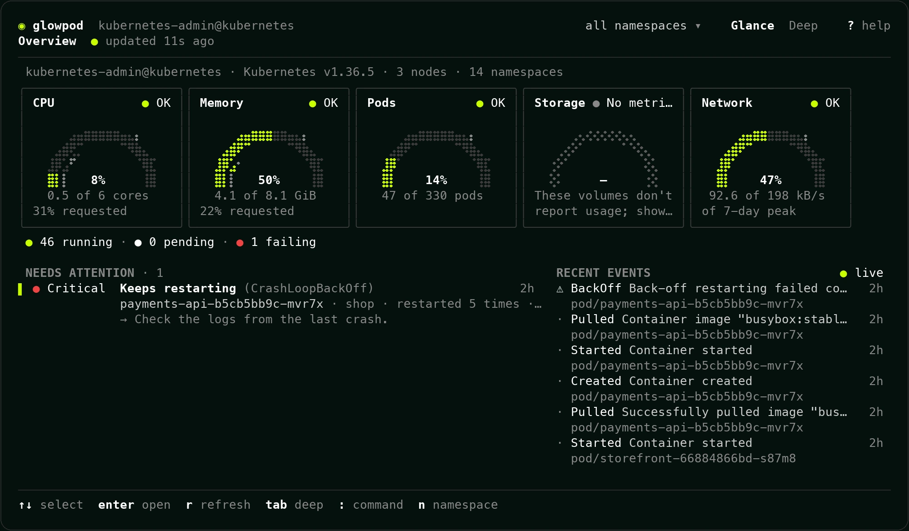
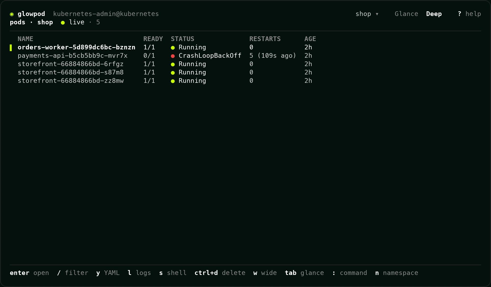
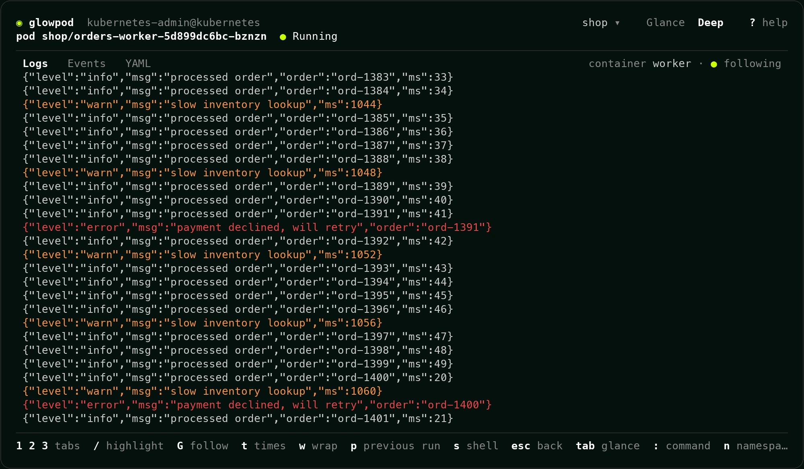
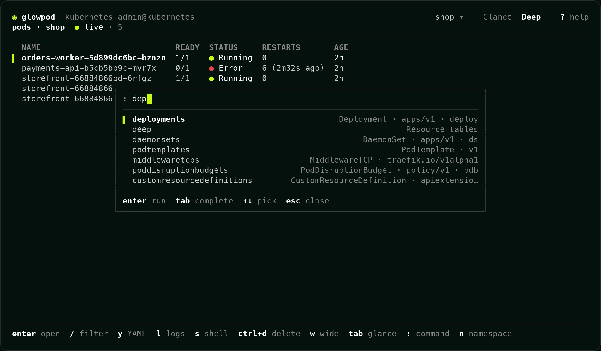
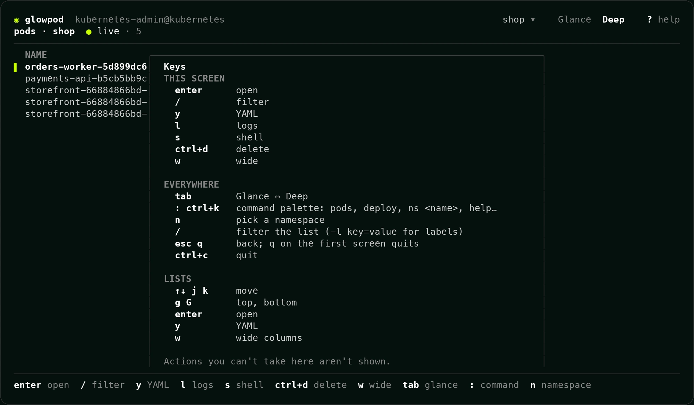

# Glowpod in the terminal

`glowpod term` is Glowpod as a terminal app: the same Glance view of your
cluster, the same plain-language answers and the same live resource lists as
the web dashboard, with keys instead of clicks. It's part of the `glowpod`
program, so there's nothing extra to install. It runs wherever your
kubeconfig works, including over SSH.



## 1. Install

macOS and Linux, with [Homebrew](https://brew.sh):

```bash
brew install glowpod-dev/tap/glowpod
```

Windows, with [Scoop](https://scoop.sh):

```powershell
scoop bucket add glowpod https://github.com/glowpod-dev/scoop-bucket
scoop install glowpod
```

Or download `glowpod` for your system (Linux, macOS or Windows, Intel or ARM)
from the [latest release](https://github.com/glowpod-dev/glowpod/releases/latest).
On Windows, use Windows Terminal: older consoles draw the gauges poorly.

## 2. Start it

```bash
glowpod term                   # Glance, across all namespaces
glowpod term -n shop           # in one namespace
glowpod term -n shop deploy    # start on a table: pods, deploy, svc, any CRD
glowpod term -context staging  # another kubeconfig context
```

It reads your kubeconfig the way `kubectl` does (`-kubeconfig`, `-context`,
`$KUBECONFIG`, then `~/.kube/config`) and acts as that user. Everything you
see and do is what your RBAC allows.

## Glance and Deep

Glance opens first: the cluster's CPU, memory, pod, storage and network
gauges, the things that need attention in plain words ("Keeps restarting
(CrashLoopBackOff)") with what to check next, and recent events.

Press `Tab` for Deep: any resource as a live table with the API server's own
columns, the same ones `kubectl get` shows. CRDs work too. `w` adds the wide
columns, `/` filters as you type (`/-l app=web` filters by label), and `n`
switches namespace.



## Logs, events and YAML

Open a pod with `Enter`, or press `l` on it, for its live logs. As in the web
dashboard, a line's own level decides its color: warnings orange, errors red.
`1`, `2` and `3` switch to Events and YAML, `p` shows the previous run after
a crash, `t` adds timestamps and `G` follows new lines again.



## The command palette

`:` (or `ctrl+k`) opens one prompt for everything: any resource by name,
singular, kind or short name (`:po`, `:deploy`, `:svc`, any CRD), a namespace
(`:ns monitoring`, `:ns all`), screens (`:glance`, `:help`) and actions on the
selected row. `Tab` completes and `Enter` runs it.



## Keys

`?` shows every key for the screen you're on.

| Key | Does |
| --- | --- |
| `Tab` | Glance ↔ Deep |
| `:` or `ctrl+k` | Command palette |
| `/` | Filter the list (`-l key=value` for labels) |
| `n` | Pick a namespace |
| `↑` `↓` or `j` `k`, `g` `G` | Move, top, bottom |
| `Enter` | Open |
| `l` | Logs |
| `y` | YAML |
| `w` | Wide columns |
| `s` | Scale a workload, or a shell in a pod |
| `r` | Restart a Deployment, StatefulSet or DaemonSet (on Glance: refresh) |
| `ctrl+d` | Delete (type the name to confirm) |
| `Esc` or `q` | Back; `q` on the first screen quits |
| `ctrl+c` | Quit |

Scale, restart, delete and shell only appear when the cluster says you may do
them. If your rights change while it's open, a refused action says so in plain
words.



## Coming next

Revealing Secret values, editing YAML, port-forward, a light theme, and
signing in to your team's in-cluster Glowpod (SSO, LDAP or a token) instead of
using a kubeconfig.
